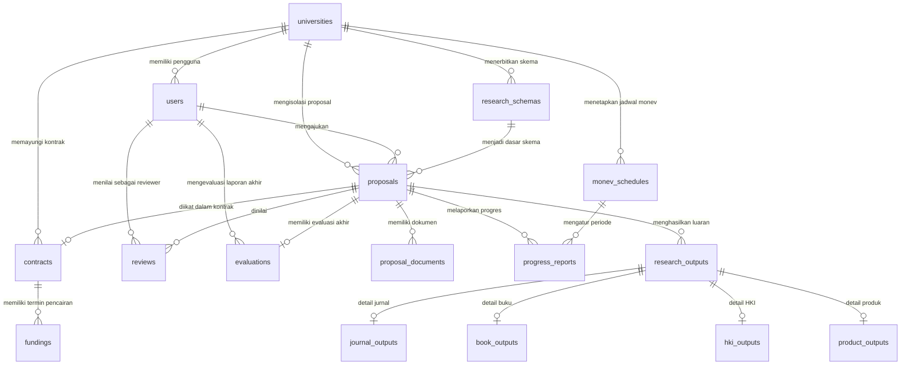

# Product Requirement Document (PRD) Komprehensif
# Sistem Penelitian Terintegrasi (Standalone Multi-Institution)

## 1. Informasi Dokumen & Ikhtisar Proyek

### 1.1 Metadata Dokumen
- **Nama Sistem**: Sistem Penelitian Terintegrasi Multi-Kampus (*Multi-Institution Research Management System* / SIM-Penelitian)
- **Versi Dokumen**: 2.0.0-STANDALONE
- **Status Dokumen**: Disetujui (Approved Baseline)
- **Tanggal Efektif**: 14 Oktober 2026
- **Target Repositori**: Repositori Fork dari `RPL-2026`
- **Repositori Asal**: `RPL-2026` (mempertahankan modul Submission System OJS - Kelas G)

### 1.2 Ringkasan Eksekutif
Dokumen ini merupakan spesifikasi kebutuhan produk dan panduan arsitektur komprehensif untuk mentransformasikan fitur Sistem Penelitian Terintegrasi (Kelas B) menjadi sebuah sistem aplikasi web yang berdiri sendiri (*standalone web application*). Sistem ini dipisahkan secara total dari ekosistem lama JurnalMu (modul akreditasi dan pembinaan Dikti) serta modul Submission System OJS (Kelas G).

Sistem hasil perombakan ini difungsikan khusus sebagai platform tata kelola siklus riset institusi akademik perguruan tinggi secara terpadu dengan arsitektur multi-institusi (*multi-tenancy*), mencakup 6 fase inti penelitian:
1. Pengelolaan Skema & Pengajuan Proposal Penelitian
2. Penugasan Reviewer & Penilaian Kriteria Substansi
3. Penerbitan Kontrak & Pencairan Dana Bertahap (Finance)
4. Monitoring dan Evaluasi (Monev) Pelaksanaan Riset
5. Pelaporan & Validasi Luaran Ilmiah (Jurnal, Buku, HKI, Produk)
6. Evaluasi Akhir Penelitian & Penerbitan Surat Keterangan Tanda Selesai (SKTS)

---

## 2. Latar Belakang & Visi Perombakan Arsitektur

### 2.1 Alasan Dekopling Sistem
Sebelum perombakan, repositori `RPL-2026` memuat tiga domain sistem yang saling bercampur dalam satu basis kode:
1. **Modul Warisan JurnalMu**: Sistem evaluasi akreditasi jurnal nasional dan pembinaan tata kelola jurnal Dikti.
2. **Modul Kelas G**: Submission System berbasis Open Journal Systems (OJS) untuk penerbitan artikel jurnal ilmiah (Author Wizard, Editorial Desk, Copyediting, Galley Production).
3. **Modul Kelas B**: Sistem Penelitian Terintegrasi untuk pengelolaan hibah riset internal LPPM perguruan tinggi.

Percampuran ini menimbulkan *code rot*, redundansi tabel basis data, kompleksitas otentikasi yang rapuh (tumpang tindih peran Editor, Reviewer OJS, Reviewer Riset, dan Admin Kampus), serta beban build frontend yang tidak efisien.

### 2.2 Visi Sistem Standalone
Melalui perombakan ini:
- Repositori asal (`RPL-2026`) tetap mempertahankan Modul Submission System OJS (Kelas G).
- Repositori *fork* didedikasikan 100% untuk **Sistem Penelitian Terintegrasi (Kelas B)**. Seluruh kode JurnalMu dan Kelas G dibersihkan secara tuntas (*clean purge*).
- Sistem diatur menjadi **Multi-Institution**, memungkinkan satu instalasi sistem digunakan oleh berbagai universitas secara aman dengan isolasi data berbasis entitas kampus.

---

## 3. Arsitektur Teknis, Tenancy, & Lingkungan Sistem

### 3.1 Technology Stack
- **Backend Framework**: Laravel 12 (PHP 8.2+)
- **Frontend Framework**: React 19 dengan TypeScript
- **Konektor Monolitik Modern**: Inertia.js 2.0
- **Bundler & Build Tool**: Vite 6+
- **CSS Engine & Desain Sistem**: Tailwind CSS 4, shadcn/ui, Lucide React Icons (bebas emoji)
- **Database Engine**: MySQL 8.0+ / MariaDB 10.4+
- **ORM**: Eloquent ORM dengan Strict Type Hints & Accessors

### 3.2 Model Isolasi Tenant Multi-Institusi (*Tenant Isolation*)
Sistem menerapkan isolasi data berbasis *Shared Database, Separate Tenancy* yang dipatok pada entitas `universities`:
- Tabel `universities` menjadi pusat relasi kepemilikan data.
- Kolom `university_id` disematkan pada seluruh tabel utama: `users`, `research_schemas`, `proposals`, `contracts`, `monev_schedules`, dan `activity_logs`.
- **Global Scope Tenant**: Seluruh kueri Eloquent untuk peran non-Super Admin secara otomatis menyaring data sesuai `auth()->user()->university_id`.
- Pengguna dari Universitas A dilarang keras membaca, mengubah, atau mengakses data milik Universitas B.

### 3.3 Keamanan & Standar Infrastruktur
- Proteksi CSRF penuh pada seluruh transmisi formulir via token Inertia/Laravel.
- Validasi unggahan berkas ketat: ekstensi diwajibkan `.pdf` untuk proposal, kontrak, dan laporan (maks. 10MB), serta format dokumen luaran tersanitasi.
- Hak akses rute dan controller dilindungi secara ganda: Middleware rute (`role:XXX`) dan otorisasi *Policy/Gate* di dalam method controller.

---

## 4. Hierarki Peran Pengguna & Matriks Hak Akses (RBAC)

Sistem menggunakan 5 peran operasional penelitian:

| Peran (Role) | Ruang Lingkup | Tanggung Jawab Utama | Akses Navigasi |
| :--- | :--- | :--- | :--- |
| **Super Admin** | Global (Lintas Kampus) | Konfigurasi sistem global, master data universitas, audit trail seluruh aktivitas. | `/admin/universities`, `/admin/settings`, `/admin/logs` |
| **Admin Kampus (LPPM)** | Kampus Tertentu | Penerbitan skema, verifikasi administrasi proposal, plotting reviewer, jadwal Monev, verifikasi luaran, penerbitan SKTS. | `/admin/schemas`, `/admin/proposals`, `/admin/assign`, `/admin/monev`, `/admin/output`, `/admin/evaluations` |
| **Admin Keuangan (Finance)** | Kampus Tertentu | Pembuatan draf kontrak hibah, penetapan termin pencairan, validasi bukti transfer/kuitansi termin dana. | `/finance/contracts`, `/finance/fundings`, `/finance/reports` |
| **Reviewer (Penilai Ahli)** | Kampus Tertentu | Menilai substansi proposal via rubrik kriteria, evaluasi berkala laporan kemajuan Monev, evaluasi akhir kelulusan riset. | `/reviewer/dashboard`, `/reviewer/proposals`, `/reviewer/monev`, `/reviewer/evaluations` |
| **Peneliti / Dosen** | Kampus Tertentu | Mengajukan proposal riset, mengunggah draf dan revisi, mengisi logbook & laporan Monev, mengklaim luaran riset, lapor akhir. | `/proposals`, `/progress`, `/outputs`, `/evaluations` |

---

## 5. Spesifikasi Fungsional 6 Modul Inti Penelitian

### 5.1 Modul 1: Manajemen Skema Pendanaan & Pengajuan Proposal

#### 1. Definisi Entitas & Deskripsi
Modul ini mengelola siklus penerbitan skema hibah riset oleh LPPM universitas dan pengajuan usulan penelitian oleh dosen/peneliti hingga lolos verifikasi berkas administrasi.

#### 2. Kebutuhan Data (Data Requirements)
- Tabel `research_schemas`: `id`, `university_id`, `nama_skema`, `deskripsi`, `biaya_maksimal`, `tanggal_mulai`, `tanggal_selesai`, `file_panduan`, `is_active`.
- Tabel `proposals`: `id`, `university_id`, `id_pengusul`, `id_skema_pendanaan`, `judul_penelitian`, `abstrak`, `latar_belakang`, `biaya_yang_diusulkan`, `status_proposal`, `catatan_administrasi`, `tanggal_pengajuan`.
- Tabel `proposal_documents`: `id`, `id_proposal`, `nama_file`, `file_path`, `file_size`, `tipe_dokumen`.

#### 3. Aturan Bisnis (Business Rules)
- Skema hanya dapat dilamar oleh dosen yang terafiliasi dengan `university_id` yang sama dengan skema tersebut.
- Pengusul tidak diperkenankan mengajukan dua proposal dengan judul yang sama pada tahun anggaran yang sama.
- Proposal yang berstatus `Submitted` tidak dapat diubah oleh dosen kecuali dikembalikan oleh Admin LPPM dengan catatan perbaikan administrasi.
- Status proposal mengikuti siklus: `Draft` -> `Submitted` -> `Administrasi_Valid` (atau `Ditolak`).

#### 4. Kebutuhan Antarmuka & Berkas Terkait
- Halaman Peneliti: `resources/js/pages/Proposal/Index.tsx`, `Create.tsx`, `Edit.tsx`, `Show.tsx`.
- Halaman Admin LPPM: `resources/js/pages/Admin/Proposal/Index.tsx`, `resources/js/pages/Admin/Schema/Index.tsx`.
- Controller: [ProposalController.php](file:///c:/xampp/htdocs/RPL-2026/app/Http/Controllers/ProposalController.php), [SchemaController.php](file:///c:/xampp/htdocs/RPL-2026/app/Http/Controllers/SchemaController.php), [DocumentController.php](file:///c:/xampp/htdocs/RPL-2026/app/Http/Controllers/DocumentController.php), `Admin/ProposalController.php`.

---

### 5.2 Modul 2: Manajemen Penugasan Reviewer & Penilaian Substansi

#### 1. Definisi Entitas & Deskripsi
Modul untuk memfasilitasi penunjukan penilai ahli (peer-reviewer) oleh Admin LPPM serta pengisian instrumen rubrik penilaian substansi proposal riset.

#### 2. Kebutuhan Data (Data Requirements)
- Tabel `assessment_criteria`: `id`, `nama_kriteria`, `bobot`, `deskripsi`, `urutan`.
- Tabel `reviews`: `id`, `id_proposal`, `id_reviewer`, `tanggal_mulai_review`, `tanggal_selesai_review`, `komponen_penilaian` (JSON), `skor_total`, `catatan_evaluasi`, `keputusan_rekomendasi`, `status_review`.

#### 3. Aturan Bisnis (Business Rules)
- Admin LPPM dapat menugaskan 1 hingga 2 orang Reviewer untuk menilai satu proposal yang telah lolos administrasi.
- Reviewer dilarang menilai proposal di mana dirinya tercatat sebagai ketua atau anggota pengusul (*Conflict of Interest Guard*).
- Pengisian skor wajib mengacu pada bobot rubrik standar (rentang akumulasi nilai: 0 - 100).
- Rekomendasi putusan terdiri dari: `Diterima`, `Ditolak`, atau `Revisi`.

#### 4. Kebutuhan Antarmuka & Berkas Terkait
- Halaman Reviewer: `resources/js/pages/Reviewer/Index.tsx`, `Reviewer/Show.tsx`.
- Halaman Admin: `resources/js/pages/Admin/Reviewer/Assign.tsx`, `Admin/Reviewer/Criteria.tsx`.
- Controller: [ReviewerController.php](file:///c:/xampp/htdocs/RPL-2026/app/Http/Controllers/ReviewerController.php), [ReviewController.php](file:///c:/xampp/htdocs/RPL-2026/app/Http/Controllers/ReviewController.php), `Admin/AssignController.php`, `Admin/CriteriaController.php`.

---

### 5.3 Modul 3: Manajemen Kontrak & Pendanaan Riset (Finance)

#### 1. Definisi Entitas & Deskripsi
Modul tata kelola kontrak hibah penelitian bagi proposal yang dinyatakan lolos didanai, pengaturan termin pencairan, dan audit bukti transfer keuangan.

#### 2. Kebutuhan Data (Data Requirements)
- Tabel `contracts`: `id`, `university_id`, `id_proposal`, `nomor_kontrak`, `judul_kontrak`, `dana_disetujui`, `tanggal_kontrak`, `file_dokumen_kontrak`, `status_kontrak`.
- Tabel `fundings`: `id`, `id_contract`, `termin_ke`, `persentase_dana`, `nominal_dana`, `tanggal_pencairan`, `bukti_transfer_path`, `status_pencairan`, `catatan_keuangan`.

#### 3. Aturan Bisnis (Business Rules)
- Kontrak hanya dapat diterbitkan untuk proposal yang berstatus `Lolos_Didanai`.
- Total persentase dana dari seluruh termin pencairan wajib berjumlah tepat 100% (contoh: Termin 1 sebesar 70%, Termin 2 sebesar 30%).
- Pencairan Termin 2 diblokir secara otomatis oleh sistem sebelum laporan kemajuan Monev (Modul 4) disetujui oleh Reviewer/LPPM.
- Bukti transfer bank/SP2D wajib dilampirkan oleh Admin Keuangan sebelum menandai status termin `Disbursed`.

#### 4. Kebutuhan Antarmuka & Berkas Terkait
- Halaman Peneliti: `resources/js/pages/Contract/Index.tsx`, `Contract/Show.tsx`.
- Halaman Keuangan: `resources/js/pages/Finance/Funding/Index.tsx`, `Finance/Funding/Disburse.tsx`.
- Controller: [ContractController.php](file:///c:/xampp/htdocs/RPL-2026/app/Http/Controllers/ContractController.php), [FundingController.php](file:///c:/xampp/htdocs/RPL-2026/app/Http/Controllers/FundingController.php), [FinanceReportController.php](file:///c:/xampp/htdocs/RPL-2026/app/Http/Controllers/FinanceReportController.php).

---

### 5.4 Modul 4: Monitoring dan Evaluasi (Monev) Pelaksanaan Riset

#### 1. Definisi Entitas & Deskripsi
Modul pemantauan kemajuan riset di tengah periode pelaksanaan hibah, pelaporan catatan harian (logbook), dan penilaian kinerja berkala oleh tim penilai.

#### 2. Kebutuhan Data (Data Requirements)
- Tabel `monev_schedules`: `id`, `university_id`, `nama_tahap`, `tanggal_mulai`, `tanggal_selesai`, `deskripsi`, `is_active`.
- Tabel `progress_reports`: `id`, `id_proposal`, `id_monev_schedule`, `persentase_kemajuan`, `ringkasan_progres`, `catatan_kendala`, `file_laporan_kemajuan`, `file_logbook`, `skor_monev`, `catatan_reviewer_monev`, `status_laporan`.

#### 3. Aturan Bisnis (Business Rules)
- Pengunggahan laporan kemajuan hanya dapat dilakukan dalam rentang tanggal jadwal Monev yang aktif.
- Dosen wajib mengunggah file laporan kemajuan berformat PDF dan persentase capaian pekerjaan riil (1% - 100%).
- Penilaian Monev oleh Reviewer menjadi prasyarat pembuka kuncian (*gatekeeper*) pencairan dana termin berikutnya.

#### 4. Kebutuhan Antarmuka & Berkas Terkait
- Halaman Dosen: `resources/js/pages/Progress/Index.tsx`, `Progress/Create.tsx`.
- Halaman Admin/Reviewer: `resources/js/pages/Admin/Monev/Index.tsx`, `Reviewer/Monev/Evaluate.tsx`.
- Controller: [ProgressController.php](file:///c:/xampp/htdocs/RPL-2026/app/Http/Controllers/ProgressController.php), [MonevDocumentController.php](file:///c:/xampp/htdocs/RPL-2026/app/Http/Controllers/MonevDocumentController.php), `Admin/MonevReportController.php`.

---

### 5.5 Modul 5: Pelaporan & Verifikasi Luaran Penelitian (Research Output)

#### 1. Definisi Entitas & Deskripsi
Modul dokumentasi bukti capaian luaran penelitian, baik luaran wajib maupun tambahan, yang diklasifikasikan ke dalam 4 kategori spesifik.

#### 2. Kebutuhan Data (Data Requirements)
- Tabel `research_outputs`: `id`, `id_proposal`, `tipe_luaran` (`Journal`, `Book`, `Hki`, `Product`), `target_status` (`Wajib`, `Tambahan`), `status_verifikasi`, `catatan_verifikasi`, `tanggal_pelaporan`.
- Tabel spesifik luaran anak:
  - `journal_outputs`: `nama_jurnal`, `judul_artikel`, `issn`, `indeksasi`, `status_publikasi`, `doi_url`, `file_artikel_path`.
  - `book_outputs`: `judul_buku`, `isbn`, `penerbit`, `tahun_terbit`, `jumlah_halaman`, `file_cover_path`.
  - `hki_outputs`: `judul_ciptaan`, `jenis_hki`, `nomor_pendaftaran`, `nomor_sertifikat`, `file_sertifikat_path`.
  - `product_outputs`: `nama_produk`, `deskripsi_produk`, `tingkat_kesiapan_teknologi` (TKT 1-9), `dokumentasi_produk_path`.

#### 3. Aturan Bisnis (Business Rules)
- Setiap proposal wajib memenuhi minimal 1 luaran berstatus `Wajib` sesuai ketentuan skema penelitian.
- Berkas bukti luaran wajib dapat diverifikasi secara fisik/digital oleh Admin LPPM sebelum status luaran berubah menjadi `Verified`.
- Dosen dapat mengunggah beberapa luaran tambahan selama masa penelitian berlangsung.

#### 4. Kebutuhan Antarmuka & Berkas Terkait
- Halaman Dosen: `resources/js/pages/Output/Index.tsx`, `Output/Create.tsx`.
- Halaman Verifikasi Admin: `resources/js/pages/Admin/Output/Verify.tsx`.
- Controller: [OutputController.php](file:///c:/xampp/htdocs/RPL-2026/app/Http/Controllers/OutputController.php), [OutputDocController.php](file:///c:/xampp/htdocs/RPL-2026/app/Http/Controllers/OutputDocController.php), `Admin/OutputReportController.php`.

---

### 5.6 Modul 6: Evaluasi Akhir Penelitian, Penutupan Kontrak, & Penerbitan SKTS

#### 1. Definisi Entitas & Deskripsi
Modul penutupan akhir siklus riset, mencakup evaluasi kelayakan berkas laporan akhir penelitian, audit capaian luaran, dan penerbitan Surat Keterangan Tanda Selesai (SKTS) oleh pimpinan LPPM.

#### 2. Kebutuhan Data (Data Requirements)
- Tabel `evaluations`: `id`, `id_proposal`, `id_evaluator`, `file_laporan_akhir`, `ringkasan_hasil`, `persentase_capaian_luaran`, `skor_akhir_substansi`, `rekomendasi_kelulusan`, `nomor_skts`, `file_skts_path`, `status_penelitian`.

#### 3. Aturan Bisnis (Business Rules)
- Evaluasi akhir hanya dapat dibuka jika laporan akhir 100% dan bukti luaran wajib telah berstatus `Verified`.
- Rekomendasi kelulusan: `Lulus_Memuaskan`, `Lulus_Cukup`, atau `Tidak_Lulus`.
- Penerbitan SKTS mengunci seluruh data proposal dan kontrak menjadi *Read-Only* (Archived).

#### 4. Kebutuhan Antarmuka & Berkas Terkait
- Halaman Evaluasi: `resources/js/pages/Evaluation/Index.tsx`, `Evaluation/Show.tsx`, `Admin/Evaluation/Index.tsx`.
- Controller: [EvaluationController.php](file:///c:/xampp/htdocs/RPL-2026/app/Http/Controllers/EvaluationController.php), [ActivityLogController.php](file:///c:/xampp/htdocs/RPL-2026/app/Http/Controllers/ActivityLogController.php).

---

## 6. Desain Basis Data Komprehensif (Data Dictionary & ERD)

### 6.1 Diagram Relasi Entitas (ERD)

### 6.2 Kamus Data 21 Tabel Bersih (*Clean Database Dictionary*)

1. **`universities`**:
   - `id`: BIGINT UNSIGNED AUTO_INCREMENT PRIMARY KEY
   - `name`: VARCHAR(255) NOT NULL
   - `code`: VARCHAR(50) UNIQUE NOT NULL
   - `address`: TEXT NULLABLE
   - `logo`: VARCHAR(255) NULLABLE
   - `contact_email`: VARCHAR(255) NULLABLE
   - `timestamps`: created_at, updated_at

2. **`roles`**:
   - `id`: BIGINT UNSIGNED AUTO_INCREMENT PRIMARY KEY
   - `name`: VARCHAR(100) UNIQUE NOT NULL (`Super Admin`, `Admin Kampus`, `Admin Keuangan`, `Reviewer`, `Peneliti`)
   - `guard_name`: VARCHAR(50) DEFAULT 'web'
   - `timestamps`: created_at, updated_at

3. **`users`**:
   - `id`: BIGINT UNSIGNED AUTO_INCREMENT PRIMARY KEY
   - `university_id`: BIGINT UNSIGNED NULLABLE (FK -> `universities.id`, ON DELETE SET NULL)
   - `role_id`: BIGINT UNSIGNED NULLABLE (FK -> `roles.id`)
   - `name`: VARCHAR(255) NOT NULL
   - `email`: VARCHAR(255) UNIQUE NOT NULL
   - `password`: VARCHAR(255) NOT NULL
   - `nidn`: VARCHAR(50) NULLABLE
   - `phone`: VARCHAR(50) NULLABLE
   - `faculty`: VARCHAR(150) NULLABLE
   - `study_program`: VARCHAR(150) NULLABLE
   - `timestamps`: created_at, updated_at

4. **`role_user`** (Pivot Role):
   - `user_id`: BIGINT UNSIGNED NOT NULL (FK -> `users.id`, ON DELETE CASCADE)
   - `role_id`: BIGINT UNSIGNED NOT NULL (FK -> `roles.id`, ON DELETE CASCADE)
   - PRIMARY KEY (`user_id`, `role_id`)

5. **`activity_logs`**:
   - `id`: BIGINT UNSIGNED AUTO_INCREMENT PRIMARY KEY
   - `user_id`: BIGINT UNSIGNED NULLABLE (FK -> `users.id`, ON DELETE SET NULL)
   - `university_id`: BIGINT UNSIGNED NULLABLE (FK -> `universities.id`, ON DELETE SET NULL)
   - `activity`: TEXT NOT NULL
   - `ip_address`: VARCHAR(45) NULLABLE
   - `user_agent`: TEXT NULLABLE
   - `timestamps`: created_at, updated_at

6. **`notifications`**:
   - `id`: BIGINT UNSIGNED AUTO_INCREMENT PRIMARY KEY
   - `user_id`: BIGINT UNSIGNED NOT NULL (FK -> `users.id`, ON DELETE CASCADE)
   - `title`: VARCHAR(255) NOT NULL
   - `message`: TEXT NOT NULL
   - `data`: JSON NULLABLE
   - `is_read`: BOOLEAN DEFAULT FALSE
   - `timestamps`: created_at, updated_at

7. **`research_schemas`**:
   - `id`: BIGINT UNSIGNED AUTO_INCREMENT PRIMARY KEY
   - `university_id`: BIGINT UNSIGNED NOT NULL (FK -> `universities.id`, ON DELETE CASCADE)
   - `nama_skema`: VARCHAR(255) NOT NULL
   - `deskripsi`: TEXT NULLABLE
   - `biaya_maksimal`: DECIMAL(15,2) NOT NULL DEFAULT 0
   - `tanggal_mulai`: DATE NOT NULL
   - `tanggal_selesai`: DATE NOT NULL
   - `file_panduan`: VARCHAR(255) NULLABLE
   - `is_active`: BOOLEAN DEFAULT TRUE
   - `timestamps`: created_at, updated_at

8. **`proposals`**:
   - `id`: BIGINT UNSIGNED AUTO_INCREMENT PRIMARY KEY
   - `university_id`: BIGINT UNSIGNED NOT NULL (FK -> `universities.id`, ON DELETE CASCADE)
   - `id_pengusul`: BIGINT UNSIGNED NOT NULL (FK -> `users.id`, ON DELETE CASCADE)
   - `id_skema_pendanaan`: BIGINT UNSIGNED NOT NULL (FK -> `research_schemas.id`, ON DELETE RESTRICT)
   - `judul_penelitian`: VARCHAR(255) NOT NULL
   - `abstrak`: TEXT NOT NULL
   - `latar_belakang`: LONGTEXT NULLABLE
   - `biaya_yang_diusulkan`: DECIMAL(15,2) NOT NULL DEFAULT 0
   - `status_proposal`: ENUM('Draft', 'Submitted', 'Administrasi_Valid', 'Ditolak', 'Lolos_Didanai') DEFAULT 'Draft'
   - `catatan_administrasi`: TEXT NULLABLE
   - `tanggal_pengajuan`: DATE NULLABLE
   - `timestamps`: created_at, updated_at

9. **`proposal_documents`**:
   - `id`: BIGINT UNSIGNED AUTO_INCREMENT PRIMARY KEY
   - `id_proposal`: BIGINT UNSIGNED NOT NULL (FK -> `proposals.id`, ON DELETE CASCADE)
   - `nama_file`: VARCHAR(255) NOT NULL
   - `file_path`: VARCHAR(255) NOT NULL
   - `file_size`: BIGINT UNSIGNED NOT NULL
   - `tipe_dokumen`: ENUM('Proposal_Utama', 'Surat_Pernyataan', 'Lampiran') DEFAULT 'Proposal_Utama'
   - `timestamps`: created_at, updated_at

10. **`assessment_criteria`**:
    - `id`: BIGINT UNSIGNED AUTO_INCREMENT PRIMARY KEY
    - `nama_kriteria`: VARCHAR(255) NOT NULL
    - `bobot`: INT UNSIGNED NOT NULL
    - `deskripsi`: TEXT NULLABLE
    - `urutan`: INT UNSIGNED DEFAULT 1
    - `timestamps`: created_at, updated_at

11. **`reviews`**:
    - `id`: BIGINT UNSIGNED AUTO_INCREMENT PRIMARY KEY
    - `id_proposal`: BIGINT UNSIGNED NOT NULL (FK -> `proposals.id`, ON DELETE CASCADE)
    - `id_reviewer`: BIGINT UNSIGNED NOT NULL (FK -> `users.id`, ON DELETE CASCADE)
    - `tanggal_mulai_review`: DATE NOT NULL
    - `tanggal_selesai_review`: DATE NOT NULL
    - `komponen_penilaian`: JSON NULLABLE
    - `skor_total`: DECIMAL(5,2) DEFAULT 0
    - `catatan_evaluasi`: TEXT NULLABLE
    - `keputusan_rekomendasi`: ENUM('Diterima', 'Ditolak', 'Revisi') NULLABLE
    - `status_review`: ENUM('Assigned', 'In_Progress', 'Completed') DEFAULT 'Assigned'
    - `timestamps`: created_at, updated_at

12. **`contracts`**:
    - `id`: BIGINT UNSIGNED AUTO_INCREMENT PRIMARY KEY
    - `university_id`: BIGINT UNSIGNED NOT NULL (FK -> `universities.id`, ON DELETE CASCADE)
    - `id_proposal`: BIGINT UNSIGNED UNIQUE NOT NULL (FK -> `proposals.id`, ON DELETE CASCADE)
    - `nomor_kontrak`: VARCHAR(100) UNIQUE NOT NULL
    - `judul_kontrak`: VARCHAR(255) NOT NULL
    - `dana_disetujui`: DECIMAL(15,2) NOT NULL
    - `tanggal_kontrak`: DATE NOT NULL
    - `file_dokumen_kontrak`: VARCHAR(255) NULLABLE
    - `status_kontrak`: ENUM('Draft', 'Signed', 'Active', 'Closed') DEFAULT 'Draft'
    - `timestamps`: created_at, updated_at

13. **`fundings`**:
    - `id`: BIGINT UNSIGNED AUTO_INCREMENT PRIMARY KEY
    - `id_contract`: BIGINT UNSIGNED NOT NULL (FK -> `contracts.id`, ON DELETE CASCADE)
    - `termin_ke`: INT UNSIGNED NOT NULL
    - `persentase_dana`: INT UNSIGNED NOT NULL
    - `nominal_dana`: DECIMAL(15,2) NOT NULL
    - `tanggal_pencairan`: DATE NULLABLE
    - `bukti_transfer_path`: VARCHAR(255) NULLABLE
    - `status_pencairan`: ENUM('Pending', 'Disbursed', 'Verified') DEFAULT 'Pending'
    - `catatan_keuangan`: TEXT NULLABLE
    - `timestamps`: created_at, updated_at

14. **`monev_schedules`**:
    - `id`: BIGINT UNSIGNED AUTO_INCREMENT PRIMARY KEY
    - `university_id`: BIGINT UNSIGNED NOT NULL (FK -> `universities.id`, ON DELETE CASCADE)
    - `nama_tahap`: VARCHAR(255) NOT NULL
    - `tanggal_mulai`: DATE NOT NULL
    - `tanggal_selesai`: DATE NOT NULL
    - `deskripsi`: TEXT NULLABLE
    - `is_active`: BOOLEAN DEFAULT TRUE
    - `timestamps`: created_at, updated_at

15. **`progress_reports`**:
    - `id`: BIGINT UNSIGNED AUTO_INCREMENT PRIMARY KEY
    - `id_proposal`: BIGINT UNSIGNED NOT NULL (FK -> `proposals.id`, ON DELETE CASCADE)
    - `id_monev_schedule`: BIGINT UNSIGNED NOT NULL (FK -> `monev_schedules.id`, ON DELETE RESTRICT)
    - `persentase_kemajuan`: INT UNSIGNED NOT NULL DEFAULT 0
    - `ringkasan_progres`: TEXT NOT NULL
    - `catatan_kendala`: TEXT NULLABLE
    - `file_laporan_kemajuan`: VARCHAR(255) NOT NULL
    - `file_logbook`: VARCHAR(255) NULLABLE
    - `skor_monev`: DECIMAL(5,2) NULLABLE
    - `catatan_reviewer_monev`: TEXT NULLABLE
    - `status_laporan`: ENUM('Submitted', 'Approved', 'Revision') DEFAULT 'Submitted'
    - `timestamps`: created_at, updated_at

16. **`research_outputs`**:
    - `id`: BIGINT UNSIGNED AUTO_INCREMENT PRIMARY KEY
    - `id_proposal`: BIGINT UNSIGNED NOT NULL (FK -> `proposals.id`, ON DELETE CASCADE)
    - `tipe_luaran`: ENUM('Journal', 'Book', 'Hki', 'Product') NOT NULL
    - `target_status`: ENUM('Wajib', 'Tambahan') DEFAULT 'Wajib'
    - `status_verifikasi`: ENUM('Draft', 'Submitted', 'Verified', 'Rejected') DEFAULT 'Draft'
    - `catatan_verifikasi`: TEXT NULLABLE
    - `tanggal_pelaporan`: DATE NULLABLE
    - `timestamps`: created_at, updated_at

17. **`journal_outputs`**:
    - `id`: BIGINT UNSIGNED AUTO_INCREMENT PRIMARY KEY
    - `id_research_output`: BIGINT UNSIGNED UNIQUE NOT NULL (FK -> `research_outputs.id`, ON DELETE CASCADE)
    - `nama_jurnal`: VARCHAR(255) NOT NULL
    - `judul_artikel`: VARCHAR(255) NOT NULL
    - `issn`: VARCHAR(50) NULLABLE
    - `indeksasi`: ENUM('Scopus', 'Sinta_1', 'Sinta_2', 'Sinta_3', 'Sinta_4', 'Internasional', 'Nasional') NOT NULL
    - `status_publikasi`: ENUM('Submitted', 'Accepted', 'Published') DEFAULT 'Submitted'
    - `doi_url`: VARCHAR(255) NULLABLE
    - `file_artikel_path`: VARCHAR(255) NULLABLE
    - `timestamps`: created_at, updated_at

18. **`book_outputs`**:
    - `id`: BIGINT UNSIGNED AUTO_INCREMENT PRIMARY KEY
    - `id_research_output`: BIGINT UNSIGNED UNIQUE NOT NULL (FK -> `research_outputs.id`, ON DELETE CASCADE)
    - `judul_buku`: VARCHAR(255) NOT NULL
    - `isbn`: VARCHAR(50) NOT NULL
    - `penerbit`: VARCHAR(255) NOT NULL
    - `tahun_terbit`: YEAR NOT NULL
    - `jumlah_halaman`: INT UNSIGNED NULLABLE
    - `file_cover_path`: VARCHAR(255) NULLABLE
    - `timestamps`: created_at, updated_at

19. **`hki_outputs`**:
    - `id`: BIGINT UNSIGNED AUTO_INCREMENT PRIMARY KEY
    - `id_research_output`: BIGINT UNSIGNED UNIQUE NOT NULL (FK -> `research_outputs.id`, ON DELETE CASCADE)
    - `judul_ciptaan`: VARCHAR(255) NOT NULL
    - `jenis_hki`: ENUM('Hak_Cipta', 'Paten', 'Desain_Industri') NOT NULL
    - `nomor_pendaftaran`: VARCHAR(100) NULLABLE
    - `nomor_sertifikat`: VARCHAR(100) NULLABLE
    - `file_sertifikat_path`: VARCHAR(255) NULLABLE
    - `timestamps`: created_at, updated_at

20. **`product_outputs`**:
    - `id`: BIGINT UNSIGNED AUTO_INCREMENT PRIMARY KEY
    - `id_research_output`: BIGINT UNSIGNED UNIQUE NOT NULL (FK -> `research_outputs.id`, ON DELETE CASCADE)
    - `nama_produk`: VARCHAR(255) NOT NULL
    - `deskripsi_produk`: TEXT NOT NULL
    - `tingkat_kesiapan_teknologi`: INT UNSIGNED DEFAULT 1
    - `dokumentasi_produk_path`: VARCHAR(255) NULLABLE
    - `timestamps`: created_at, updated_at

21. **`evaluations`**:
    - `id`: BIGINT UNSIGNED AUTO_INCREMENT PRIMARY KEY
    - `id_proposal`: BIGINT UNSIGNED UNIQUE NOT NULL (FK -> `proposals.id`, ON DELETE CASCADE)
    - `id_evaluator`: BIGINT UNSIGNED NULLABLE (FK -> `users.id`, ON DELETE SET NULL)
    - `file_laporan_akhir`: VARCHAR(255) NOT NULL
    - `ringkasan_hasil`: LONGTEXT NOT NULL
    - `persentase_capaian_luaran`: INT UNSIGNED DEFAULT 0
    - `skor_akhir_substansi`: DECIMAL(5,2) DEFAULT 0
    - `rekomendasi_kelulusan`: ENUM('Lulus_Memuaskan', 'Lulus_Cukup', 'Tidak_Lulus') NULLABLE
    - `nomor_skts`: VARCHAR(100) UNIQUE NULLABLE
    - `file_skts_path`: VARCHAR(255) NULLABLE
    - `status_penelitian`: ENUM('Dalam_Evaluasi', 'Selesai', 'Gagal') DEFAULT 'Dalam_Evaluasi'
    - `timestamps`: created_at, updated_at

---

## 7. Peta Routing & Antarmuka Inertia.js

Seluruh rute dikelompokkan berdasarkan middleware peran (`role:XXX`):

### 7.1 Grup Peneliti / Dosen (`role:Peneliti`)
- `GET /proposals` -> `ProposalController@index` -> `Proposal/Index.tsx`
- `GET /proposals/create` -> `ProposalController@create` -> `Proposal/Create.tsx`
- `POST /proposals` -> `ProposalController@store`
- `GET /proposals/{id}` -> `ProposalController@show` -> `Proposal/Show.tsx`
- `GET /proposals/{id}/edit` -> `ProposalController@edit` -> `Proposal/Edit.tsx`
- `PUT /proposals/{id}` -> `ProposalController@update`
- `DELETE /proposals/{id}` -> `ProposalController@destroy`
- `POST /documents/upload` -> `DocumentController@upload`
- `GET /progress` -> `ProgressController@index` -> `Progress/Index.tsx`
- `POST /progress` -> `ProgressController@store`
- `GET /outputs` -> `OutputController@index` -> `Output/Index.tsx`
- `POST /outputs` -> `OutputController@store`
- `GET /evaluations/my-final-report` -> `EvaluationController@show` -> `Evaluation/Show.tsx`

### 7.2 Grup Reviewer (`role:Reviewer`)
- `GET /reviewer/dashboard` -> `ReviewerController@index` -> `Reviewer/Index.tsx`
- `GET /reviewer/proposals/{id}` -> `ReviewController@show` -> `Reviewer/Show.tsx`
- `POST /reviewer/proposals/{id}/assessment` -> `ReviewController@storeAssessment`
- `POST /reviewer/monev/{id}` -> `ProgressController@evaluateMonev`
- `POST /reviewer/evaluations/{id}` -> `EvaluationController@evaluateFinal`

### 7.3 Grup Admin Keuangan (`role:Admin Keuangan`)
- `GET /finance/contracts` -> `ContractController@index` -> `Contract/Index.tsx`
- `POST /finance/contracts` -> `ContractController@store`
- `GET /finance/fundings` -> `FundingController@index` -> `Finance/Funding/Index.tsx`
- `POST /finance/fundings/{id}/disburse` -> `FundingController@disburse` -> `Finance/Funding/Disburse.tsx`
- `GET /finance/reports` -> `FinanceReportController@index`

### 7.4 Grup Admin Kampus / LPPM (`role:Admin Kampus`)
- `GET /admin/schemas` -> `SchemaController@index` -> `Admin/Schema/Index.tsx`
- `POST /admin/schemas` -> `SchemaController@store`
- `GET /admin/proposals` -> `Admin/ProposalController@index` -> `Admin/Proposal/Index.tsx`
- `POST /admin/proposals/{id}/verify` -> `Admin/ProposalController@approve`
- `POST /admin/assign` -> `Admin/AssignController@assign`
- `GET /admin/monev` -> `Admin/MonevReportController@index` -> `Admin/Monev/Index.tsx`
- `POST /admin/output/{id}/verify` -> `Admin/OutputVerifyCtrl@verify`
- `POST /admin/evaluations/{id}/certify` -> `EvaluationController@generateSkts`

### 7.5 Grup Super Admin (`role:Super Admin`)
- `GET /admin/universities` -> `Admin/UniversityController@index` -> `Admin/University/Index.tsx`
- `GET /admin/users` -> `Admin/UserController@index` -> `Admin/User/Index.tsx`
- `GET /admin/logs` -> `Admin/LogController@index`
- `GET /admin/settings` -> `Admin/SettingsCtrl@index`

---

## 8. Purge Manifest & Blueprint Pembersihan (Repositori Fork)

Daftar inventaris berkas dan direktori yang dieliminasi secara tuntas dari repositori *fork*:

### 8.1 Berkas Controller Dihapus
- `app/Http/Controllers/SubmissionController.php`
- `app/Http/Controllers/SubmissionWizardController.php`
- `app/Http/Controllers/DiscussionController.php`
- `app/Http/Controllers/CitationController.php`
- `app/Http/Controllers/PublicJournalController.php`
- `app/Http/Controllers/ReviewerProfileController.php`
- `app/Http/Controllers/EmailTemplateController.php`
- Seluruh isi folder: `app/Http/Controllers/Editorial/`
- Seluruh isi folder: `app/Http/Controllers/Copyediting/`
- Seluruh isi folder: `app/Http/Controllers/Production/`
- Seluruh isi folder: `app/Http/Controllers/Revision/`
- Seluruh isi folder: `app/Http/Controllers/Dikti/`
- Seluruh isi folder: `app/Http/Controllers/AdminKampus/`
- Controller legacy di `app/Http/Controllers/Admin/`: `AccreditationTemplateController.php`, `AssessmentController.php`, `BorangIndikatorController.php`, `EssayQuestionController.php`, `EvaluationCategoryController.php`, `EvaluationIndicatorController.php`, `EvaluationSubCategoryController.php`, `JournalController.php`, `PembinaanController.php`, `DataMasterController.php`.

### 8.2 Berkas Model Dihapus
- `app/Models/Submission.php`, `SubmissionFile.php`, `SubmissionContributor.php`, `SubmissionDiscussion.php`, `DiscussionMessage.php`
- `app/Models/EditorialAssignment.php`, `EditorialDecision.php`, `CopyeditingTask.php`, `RevisionRound.php`, `ProductionIssue.php`, `PlagiarismCheck.php`, `Galley.php`, `Issue.php`, `Article.php`, `Journal.php`
- `app/Models/AuthorProfile.php`, `ReviewAssignment.php`, `ReviewDecision.php`, `ReviewerAssignment.php`, `ReviewForm.php`, `EmailTemplate.php`
- `app/Models/AccreditationTemplate.php`, `Agenda.php`, `AssessmentAttachment.php`, `AssessmentIssue.php`, `AssessmentJournalMetadata.php`, `AssessmentNote.php`, `AssessmentResponse.php`
- `app/Models/EssayQuestion.php`, `EvaluationCategory.php`, `EvaluationIndicator.php`, `EvaluationSubCategory.php`, `JournalAssessment.php`, `JournalReassignment.php`
- `app/Models/Pembinaan.php`, `PembinaanRegistration.php`, `PembinaanRegistrationAttachment.php`, `PembinaanReview.php`, `ScientificField.php`.

### 8.3 Berkas Frontend Dihapus
- `resources/js/pages/Submission/`
- `resources/js/pages/Editorial/`, `Copyediting/`, `Production/`, `Revision/`, `Discussion/`, `Journals/`, `Public/`, `Browse/`, `Dikti/`, `AdminKampus/`
- `resources/js/pages/Resources.tsx`, `Support.tsx`
- Komponen OJS: `WizardProgressBar.tsx`, `KeywordInput.tsx`, `ContributorForm.tsx`, `SubmissionStatusBadge.tsx`, `SubmissionTimeline.tsx`, `RevokeRoleModal.tsx`, `RoleBadge.tsx`.

---

## 9. Skenario Kasus Batas (Edge Cases) & Penanganan Sistem

Sistem dirancang tangguh (*fault-tolerant*) dalam menghadapi berbagai kasus batas operasional:

### 9.1 Kasus Batas Multi-Tenancy & Organisasi
1. **Manipulasi Akses Lintas Kampus (IDOR via URL Parameter)**:
   - *Kasus*: Pengguna dari Universitas A mencoba mengakses `/proposals/123` di mana proposal tersebut milik Universitas B.
   - *Penanganan*: Global Tenant Scope pada Eloquent dan otorisasi *Policy* secara otomatis melempar `403 Forbidden` atau `404 Not Found`.
2. **Konflik Kepentingan Reviewer (*Conflict of Interest*)**:
   - *Kasus*: Admin LPPM tidak sengaja memilih Reviewer yang merupakan pengusul utama atau anggota pada proposal target.
   - *Penanganan*: Controller `Admin/AssignController@assign` memvalidasi relasi pengusul: jika `id_reviewer == id_pengusul`, sistem membatalkan plotting dengan pesan validasi "Reviewer memiliki konflik kepentingan dengan proposal ini."
3. **Universitas Dinonaktifkan**:
   - *Kasus*: Super Admin menonaktifkan akun institusi universitas tertentu.
   - *Penanganan*: Seluruh login civitas kampus tersebut dicegat oleh middleware otentikasi dengan status *Account Suspended*.

### 9.2 Kasus Batas Pengajuan & Penilaian Proposal
4. **Batas Waktu Skema Berakhir Saat Dosen Mengisi Form (*Deadline Race Condition*)**:
   - *Kasus*: Dosen membuka form pukul 23.55 dan menekan tombol *submit* pada pukul 00.02 ketika tanggal skema telah kedaluwarsa.
   - *Penanganan*: Validasi sisi backend pada `StoreProposalRequest` memeriksa `now() <= schema.tanggal_selesai`. Jika lewat, transaksi ditolak dan form dikembalikan dengan pesan "Batas waktu penerimaan proposal untuk skema ini telah berakhir."
5. **Kirim Ganda Akibat Koneksi Lemah (*Double Submission / Idempotency*)**:
   - *Kasus*: Pengguna menekan tombol "Ajukan Proposal" berkali-kali karena latensi jaringan.
   - *Penanganan*: Frontend menonaktifkan (*disable*) tombol simpan saat status form *isSubmitting*, dan backend menggunakan database unique constraint pada judul + pengusul + tahun anggaran.
6. **Reviewer Menghilang / Terlambat (*Reviewer Abandonment / Ghosting*)**:
   - *Kasus*: Reviewer yang diplot tidak kunjung mengisi penilaian hingga melewati `tanggal_selesai_review`.
   - *Penanganan*: Sistem menampilkan lencana *Overdue* pada dashboard Admin LPPM, dan menyediakan fungsi *Re-assign / Cabut Tugas* untuk mengalihkan proposal ke reviewer pengganti tanpa merusak data proposal.
7. **Perbedaan Skor Ekstrem Antara Dua Reviewer**:
   - *Kasus*: Reviewer 1 memberi skor 90 (Diterima), sedangkan Reviewer 2 memberi skor 40 (Ditolak) (selisih > 30 poin).
   - *Penanganan*: Sistem memberikan notifikasi visual *Discrepancy Warning* kepada Admin LPPM untuk menunjuk Reviewer ke-3 (*tie-breaker*) sebelum keputusan final diambil.

### 9.3 Kasus Batas Kontrak & Keuangan
8. **Penyesuaian Anggaran Pasca-Review (*Budget Cut / Adjustment*)**:
   - *Kasus*: Dosen mengajukan Rp 20.000.000, namun reviewer dan LPPM hanya menyetujui pendanaan sebesar Rp 15.000.000.
   - *Penanganan*: Kolom `dana_disetujui` pada tabel `contracts` mencatat nilai riil keputusan LPPM, dan pembagian nominal termin dihitung otomatis berdasarkan `dana_disetujui`, bukan biaya usulan awal.
9. **Permintaan Pencairan Termin 2 Tanpa Kelulusan Monev (*Termin Blocker*)**:
   - *Kasus*: Bendahara mencoba mencairkan Termin 2 ketika dosen belum mengunggah laporan kemajuan atau laporan Monev belum di-approve.
   - *Penanganan*: Backend melempar error `422 Unprocessable Content`: "Pencairan dana Termin 2 diblokir sampai Laporan Kemajuan Monev disetujui."

### 9.4 Kasus Batas Pelaporan Luaran & Evaluasi Akhir
10. **Klaim Luaran Ganda (*Duplicate Output Claim*)**:
    - *Kasus*: Peneliti mendaftarkan satu artikel jurnal yang sama untuk memenuhi kewajiban dua kontrak penelitian yang berbeda.
    - *Penanganan*: Pengecekan keunikan nomor registrasi (DOI pada jurnal, ISBN pada buku, atau nomor permohonan HKI) di level basis data per institusi.
11. **Penelitian Gagal / Force Majeure**:
    - *Kasus*: Peneliti tidak dapat merampungkan penelitian karena sakit berat atau bencana.
    - *Penanganan*: Admin LPPM dapat menetapkan status evaluasi akhir menjadi `Gagal`, yang secara otomatis membatalkan sisa pencairan dana dan menerbitkan surat penutupan khusus dengan audit keuangan pengembalian sisa dana.

---

## 10. Kriteria Penerimaan & Jaminan Kualitas (QA & Acceptance Criteria)

### 10.1 Kriteria Keberhasilan Fungsional
1. Siklus penelitian end-to-end dapat berjalan mulus dari pengajuan skema hingga penerbitan SKTS tanpa error relasi database.
2. Tidak ada kebocoran data antar universitas pada seluruh antarmuka dan API endpoint.
3. Seluruh berkas yang terdaftar pada *Purge Manifest* telah bersih 100% dari direktori repositori fork.
4. Perintah `php artisan migrate:fresh --seed` berjalan sukses tanpa galat foreign key atau dependency missing.
5. Perintah build frontend `npm run build` selesai tanpa error kompilasi TypeScript atau linting.

### 10.2 Standar Koding & Pengujian
- Seluruh controller harus memiliki validasi FormRequest terpisah (`app/Http/Requests/`).
- Pengujian otomatis backend menggunakan PHPUnit Feature Tests untuk skenario positif dan negatif setiap peran.
- Tampilan frontend wajib responsif pada resolusi desktop (1280px+) dan tablet (768px+) menggunakan komponen shadcn/ui bebas emoji.
